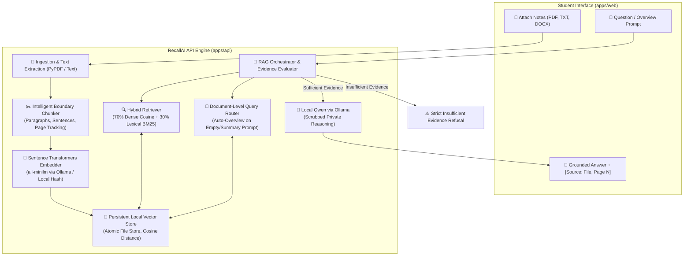

# 🧠 RecallAI — Persistent AI Study Companion & Grounded Local RAG Pipeline

> **Privacy-First, Local-First Academic Study Companion with Document-Grounded RAG, Dense Semantic & BM25 Hybrid Retrieval, Traceable Citations, and Modular Graph Memory.**

[](https://nodejs.org/)
[](https://nextjs.org/)
[](https://react.dev/)
[](https://ollama.com/)
[]()
[]()
[](https://www.typescriptlang.org/)

---

## ⚡ 1. Quickstart (Under 2 Minutes)

RecallAI runs **100% locally** with zero external paid APIs, cloud keys, or data exfiltration.

### Step 1: Clone the Repository
```bash
git clone https://github.com/rishu981/recall-ai-fixed-rag-pipeline-.git
cd recall-ai-fixed-rag-pipeline-
npm install
```

### Step 2: Ensure Ollama is Running
RecallAI leverages local Sentence Transformers embeddings (`all-minilm`) and local Qwen inference:
```bash
# Pull the models
ollama pull qwen3.5:4b
ollama pull all-minilm

# Start Ollama
ollama serve
```
*(Note: If Ollama is offline or model is missing, RecallAI activates resilient local deterministic hash embeddings and internal pedagogical fallbacks without crashing).*

### Step 3: Launch Web & API Concurrently
```bash
npm run dev
```
- **Web Frontend:** [http://localhost:3000](http://localhost:3000)
- **API Backend:** [http://localhost:4000](http://localhost:4000)

---

## 🏛️ 2. Rebuilt RAG Architecture

RecallAI features an end-to-end, locally runnable Retrieval-Augmented Generation (RAG) pipeline designed specifically for academic rigor and strict grounding.



---

## 🚀 3. Key Pipeline Capabilities

### 1. Robust Document Ingestion & Text Extraction
- **Multi-Format Support:** Ingests PDF (`pdf-parse`), plaintext (`.txt`, `.md`), and Word documents (`.docx`).
- **Page-Level Tracking:** Tracks document ID, filename, page numbers, character offsets, and SHA256 checksums.
- **Scanned / OCR Detection:** Gracefully detects empty or image-only scanned PDFs and alerts the user rather than creating empty chunks.

### 2. Intelligent Text Chunking
- Avoids arbitrary character truncation.
- Preserves paragraph and sentence boundaries wherever possible.
- Configurable chunk size (`800` chars default) and overlap (`150` chars default).
- Every chunk includes metadata: `documentId`, `filename`, `pageNumber`, `chunkIndex`, `charCount`, and `sha256`.

### 3. Sentence Transformers Local Embeddings
- Generates 384-dimensional dense vectors using local `all-minilm`.
- Reuses cached embeddings connection across requests.
- Deterministic 384-dim hash fallback ensures uninterrupted offline operation if Ollama is unreachable.

### 4. Persistent Local Vector Store
- Atomic JSON-backed vector database (`apps/api/data/vector-store.json`).
- Survives application and server restarts.
- Supports document indexing, metadata querying, chunk listing, and document deletion.
- Fast cosine similarity search with user scoping and document filtering.

### 5. Hybrid Retrieval System
- **Dense Semantic Search:** Cosine distance matching of user intent against chunk vectors.
- **Lexical BM25 Scoring:** Exact keyword token matching filtering out academic stopwords.
- **Hybrid Fusion:** Combines 70% dense similarity with 30% keyword overlap.
- **Automatic Document Overview:** If a user submits an empty query with an attachment or asks for a summary, it automatically pulls representative introductory and structural sections.

### 6. Strict Grounded Generation (Mode A vs Mode B)
- **Mode A (Document-Grounded):** Cites source files and page numbers (`[Source: filename, Page N]`). If the material does not contain the answer, it strictly outputs:
  > *"I couldn't find sufficient supporting information in your uploaded materials to answer that reliably."*
- **Mode B (General Knowledge):** Clearly differentiates general academic knowledge when no document is attached.
- **Reasoning Sanitizer:** Scrubs internal `<think>...</think>` tokens to ensure clean presentation.

### 7. Modular Graph Memory (FalkorDB Decoupled)
- FalkorDB integration uses the `GraphMemoryProvider` interface with a robust `DisabledGraphMemoryProvider`.
- Works out-of-the-box without requiring a running FalkorDB instance or cloud URL.
- Ready for future plug-in via `FALKORDB_URL`.

---

## 🧪 4. Testing & Verification

Run the full verification and test suite:

```bash
# Typecheck monorepo
npm run verify

# Run RAG pipeline unit and regression tests
npx tsx apps/api/test/rag-pipeline.test.ts

# Run live stream test against uploaded documents
npx tsx apps/api/test/test-safescript-stream.ts
```

**Verification Highlights:**
- ✅ 18/18 RAG pipeline regression tests passing.
- ✅ Zero TypeScript compiler errors across `@recallai/web` and `@recallai/api`.
- ✅ End-to-end verified on real-world proposals (`SafeScript_AI_Technical_Proposal.pdf`) generating grounded answers with citations.

---

## 📂 5. Project Structure

```
recall-ai-fixed-rag-pipeline-/
├── apps/
│   ├── api/                           # Express + TypeScript Backend
│   │   ├── data/                      # Persistent vector store database
│   │   ├── src/
│   │   │   ├── db/                    # Memory & relational repositories
│   │   │   ├── routes/                # REST endpoints (conversations, messages, uploads)
│   │   │   └── services/rag/          # Complete RAG Pipeline
│   │   │       ├── chunker.ts         # Intelligent paragraph/sentence chunker
│   │   │       ├── embeddings.ts      # Sentence Transformers embedding provider
│   │   │       ├── vector-store.ts    # Persistent local vector store
│   │   │       ├── retrieval.ts       # Hybrid semantic + BM25 retrieval
│   │   │       ├── orchestrator.ts    # RAG intent classification & flow
│   │   │       ├── grounded-generator.ts # Strict Mode A/B prompt builder
│   │   │       └── graph-memory-provider.ts # Modular FalkorDB provider
│   │   └── test/                      # E2E & unit test suites
│   └── web/                           # Next.js 15 + React 19 Frontend
│       ├── src/
│       │   ├── components/            # Chat composer, messages, attachments
│       │   ├── store/                 # Reactive AppStore state management
│       │   └── lib/                   # API clients & utilities
├── packages/
│   └── shared-types/                  # Shared TypeScript interfaces
├── package.json                       # Monorepo workspaces
└── Readme.md                          # Architecture & setup guide
```

---

## 🛡️ License

MIT License. Designed for privacy-first, locally-run AI academic learning.
